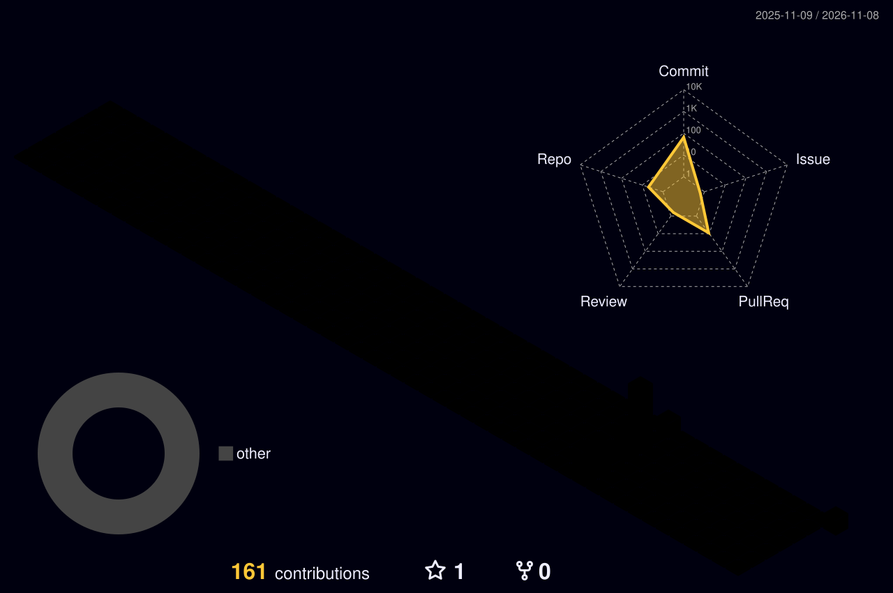

<!--
  ╔══════════════════════════════════════════════════════════════╗
  ║  NEON GRID PROFILE                                          ║
  ║  Theme: Cyberpunk / Neon • Hexagonal Skill Tree             ║
  ╚══════════════════════════════════════════════════════════════╝
-->

<div align="center">

<!-- HERO: Deep-space banner + neon typing -->


<a href="https://github.com/RootedHost">
  
</a>

<br/>

<p>
  <a href="YOUR_LINKEDIN_URL"></a>
  <a href="https://instagram.com/Demonz.og"></a>
  <a href="https://github.com/RootedHost?tab=followers"></a>
  
</p>

</div>

<br/>

<!-- ABOUT ME: Terminal card -->
<div align="center">
  
</div>

<br/>

<h2 align="center" style="color:#00FFFF;">⚡ <span style="color:#a855f7;">Developer Console</span></h2>

<table width="100%" style="border: none; border-collapse: collapse;">
  <tr>
    <td width="60%" valign="top" style="border: none;">

### 👨‍💻 `$ whoami`
Backend developer focused on building robust, scalable systems and automating complex workflows. I work mostly in **Python**, **PHP**, and **system infrastructure**, and I care about code that stays fast and clean under real load.

- 🔭 Building: Custom APIs & automation pipelines
- 🌱 Learning: Advanced system design & cloud infrastructure
- 💬 Ask me about: Backend logic, API design, debugging

    </td>
    <td width="40%" valign="top" style="border: none;">

### ⚙️ `$ cat config.yml`

```yaml
profile:
  name: "Prathyaksh Shetty"
  handle: "@RootedHost"
  role: "Backend & Automation"
  status: "Open to Collaborations"
  stack: ["Python", "PHP", "MySQL", "MongoDB"]
```

    </td>
  </tr>
</table>

<br/>

<!-- ═══════════════════════════════════════════════════════════════════
     HEXAGONAL TECH ARSENAL
     This is a pre-rendered SVG skill tree with hexagonal nodes.
     Replace the URL parameters if you want to change the skills.
     ═══════════════════════════════════════════════════════════════════ -->

<h2 align="center" style="color:#E4405F;">🛠️ <span style="color:#00FFFF;">Hex Tech Grid</span></h2>

<div align="center">
  
</div>

<br/>

<!-- FALLBACK SKILL ICONS (if the skill-tree service is down) -->
<p align="center"><b>Core Stack</b></p>
<p align="center">
  
</p>

<br/>

<!-- ═══════════════════════════════════════════════════════════════════
     NEON STATS & TELEMETRY
     ═══════════════════════════════════════════════════════════════════ -->

<h2 align="center" style="color:#a855f7;">📊 <span style="color:#00FFFF;">Telemetry</span></h2>

<div align="center">
  <a href="https://github.com/RootedHost">
    
  </a>
  <a href="https://github.com/RootedHost">
    
  </a>
</div>

<br/>

<div align="center">
  <a href="https://github.com/RootedHost">
    
  </a>
</div>

<br/>

<div align="center">
  <a href="https://github.com/RootedHost">
    
  </a>
</div>

<br/>

<!-- ═══════════════════════════════════════════════════════════════════
     CONTRIBUTION VISUALS
     ═══════════════════════════════════════════════════════════════════ -->

<h2 align="center" style="color:#00FFFF;">🌐 <span style="color:#E4405F;">Contribution Grid</span></h2>

<div align="center">
  <picture>
    <source media="(prefers-color-scheme: dark)" srcset="https://raw.githubusercontent.com/RootedHost/RootedHost/main/profile-3d-contrib/profile-night-rainbow.svg">
    <source media="(prefers-color-scheme: light)" srcset="https://raw.githubusercontent.com/RootedHost/RootedHost/main/profile-3d-contrib/profile-green-animate.svg">
    
  </picture>
</div>

<br/>

<div align="center">
  <picture>
    <source media="(prefers-color-scheme: dark)" srcset="https://raw.githubusercontent.com/RootedHost/RootedHost/output/github-snake-dark.svg">
    <source media="(prefers-color-scheme: light)" srcset="https://raw.githubusercontent.com/RootedHost/RootedHost/output/github-snake.svg">
    
  </picture>
</div>

<br/>

<!-- FOOTER -->
<div align="center">
  
</div>
